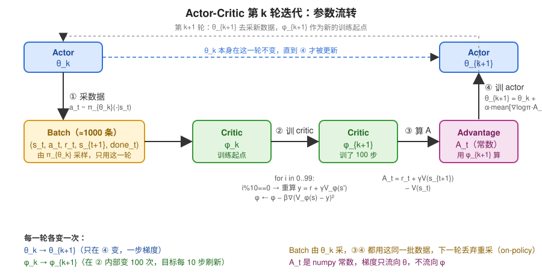

# HW3 学习笔记：Actor-Critic

## 1. 从 hw2 的策略梯度出发

hw2 更新策略的公式：

```
∇J ≈ mean[ ∇ log π(a|s) · A(s,a) ]
```

**A 大的动作，提高它的概率；A 小（负）的动作，降低它的概率。**
A 叫 advantage，衡量"这个动作比平均水平好多少"。

hw2 里 A 这么算：

```
A(s_t, a_t) = (从 t 开始实际拿到的 reward 之和)  −  V(s_t)
              ↑ reward-to-go，用一整条真实轨迹算出来
```

问题：reward-to-go 是**一整条轨迹后面所有随机性的总和**——后面每一步策略的随机采样、
环境的随机性全混进来。同一个 (s, a) 跑两次，可能一次 +80 一次 −30。这就是"方差大"。
方差大 → 梯度估计噪声大 → 需要很多样本、学得慢。

## 2. 核心想法：用估计代替实际求和

reward-to-go 是"从 s_t 开始未来 reward 之和"，而 V(s) 定义上就是"从 s 开始未来 reward 之和的期望"。
直接拿 V 代替：

```
reward-to-go ≈ r_t + γ · V(s_{t+1})
                ↑ 真实的一步      ↑ 剩下的全部交给 V 估计
```

于是 advantage 变成：

```
A(s_t, a_t) = r_t + γ·V(s_{t+1}) − V(s_t)
```

只有 r_t 一个随机量，其余是网络输出的确定值。方差小很多。
代价是 V 估不准时会有偏差——RL 里经典的 **bias-variance 权衡**。

对应代码 `agents/ac_agent.py` → `estimate_advantage`：

```python
def estimate_advantage(self, ob_no, next_ob_no, re_n, terminal_n):
    v_t   = self.critic.forward_np(ob_no)         # V(s)
    v_tp1 = self.critic.forward_np(next_ob_no)    # V(s')
    q_n   = re_n + self.gamma * v_tp1 * (1 - terminal_n)   # r + γV(s')，终止时截掉 V(s')
    adv_n = q_n - v_t                             # A = Q − V

    if self.standardize_advantages:
        adv_n = (adv_n - np.mean(adv_n)) / (np.std(adv_n) + 1e-8)
    return adv_n
```

## 3. 这里用 Q 了吗？

用了，但**没有单独学一个 Q 网络**。Q 是用 V 拼出来的。

```
Q(s, a) = 在 s 做动作 a 之后，未来 reward 之和的期望
V(s)    = 在 s 按策略 π 行动，未来 reward 之和的期望
```

精确关系——Q 可以拆成"这一步的 reward"加"下一个状态的 V"：

```
Q(s, a) = r(s, a) + γ · V(s')
```

做完 a 拿到 r，到了 s'，之后按策略走，剩下的期望就是 V(s')。
代码里那行变量名就叫 `q_n`。advantage 的本来定义就是 **A = Q − V**：

```
A(s,a) = Q(s,a) − V(s) = [r + γV(s')] − V(s)
```

"这个动作比平均水平好多少" = "做这个动作能拿到的" − "平均能拿到的"。

**为什么不直接学 Q 网络？**
1. 省一个网络。有 V，Q 一行就能算。
2. V 比 Q 好学。V 只依赖 s；Q 依赖 (s, a)，连续动作时 a 有无穷多取值，要覆盖的空间大得多。

| | DQN | Actor-Critic（本作业） |
|---|---|---|
| 学的网络 | Q(s, a) | V(s) |
| Q 从哪来 | 网络直接输出 | `r + γV(s')` 拼出来 |
| Q 拿来干嘛 | 直接 argmax 当策略 | 减去 V 得 A，喂给 actor 做策略梯度 |

DQN 必须学 Q，因为它没有单独的策略，全靠 `argmax_a Q(s,a)` 选动作，V 不带动作做不到。
Actor-critic 有自己的策略网络，不靠 Q 选动作，只学 V 就够。
（有些变体确实学 Q 而不是 V，如 SAC/DDPG，那是另一套思路。）

## 4. 两个角色

| | 是什么 | 学什么 | 代码 |
|---|---|---|---|
| **Actor** | 策略网络 π(a\|s) | 用 A 做策略梯度，和 hw2 一样 | `policies/MLP_policy.py` → `MLPPolicyAC.update` |
| **Critic** | 价值网络 V(s) | 回归到 TD 目标 `r + γV(s')` | `critics/bootstrapped_continuous_critic.py` → `update` |

Actor 负责"做决定"，Critic 负责"打分"告诉 Actor 刚才那步好不好。

### Actor

```python
class MLPPolicyAC(MLPPolicy):
    def update(self, observations, actions, adv_n=None):
        observations = ptu.from_numpy(observations)
        actions = ptu.from_numpy(actions)
        adv_n = ptu.from_numpy(adv_n)

        action_distribution = self.forward(observations)     # π(·|s)：离散是 Categorical，连续是高斯
        log_prob = action_distribution.log_prob(actions)     # log π(a|s)
        loss = -(log_prob * adv_n).mean()                    # 最大化 E[log π · A]，取负给 optimizer 最小化

        self.optimizer.zero_grad()
        loss.backward()
        self.optimizer.step()
        return loss.item()
```

和 hw2 的 `MLPPolicyPG.update` 完全一样，只是 advantage 从外面传进来，没有 nn_baseline（baseline 的活交给 critic 了）。

### Critic：又是"自己教自己"

Critic 的目标值 `y = r + γ · V(s')` 里面有 V 自己——和 DQN 一样的问题：你往目标走一步，目标跟着动。

DQN 的解法是冻结的 target 网络。这里用更轻量的办法：**先冻住目标算几步，再重算目标**：

```python
def update(self, ob_no, ac_na, next_ob_no, reward_n, terminal_n):
    ob_no      = ptu.from_numpy(ob_no)
    next_ob_no = ptu.from_numpy(next_ob_no)
    reward_n   = ptu.from_numpy(reward_n)
    terminal_n = ptu.from_numpy(terminal_n)

    for i in range(self.num_grad_steps_per_target_update * self.num_target_updates):  # 10 × 10 = 100 步
        if i % self.num_grad_steps_per_target_update == 0:        # 每 10 步（含第 0 步）
            with torch.no_grad():                                 # 冻住：目标是常数，不传梯度
                v_tp1 = self(next_ob_no)
                target_n = reward_n + self.gamma * v_tp1 * (1 - terminal_n)   # 重算目标

        v_t = self(ob_no)
        loss = self.loss(v_t, target_n)                           # MSE，向固定目标回归

        self.optimizer.zero_grad()
        loss.backward()
        self.optimizer.step()

    return loss.item()
```

命令行里 `-ntu 10 -ngsptu 10` 就是 `num_target_updates`（重算目标 10 次）和
`num_grad_steps_per_target_update`（每次目标固定后走 10 步梯度）。
`with torch.no_grad()` 等价于 DQN 里的 `target.detach()`。

作业 PDF 里描述的过程：
1. 用当前 V 算目标
2. 向目标回归几步
3. 重复 1、2 若干次

PDF 明确说"这个迭代过程对训练 critic 至关重要"——如果 ntu=1 只算一次目标，V 学到的是基于旧 V 的一个很差的估计。

## 5. `train` 把它们串起来

```python
def train(self, ob_no, ac_na, re_n, next_ob_no, terminal_n):
    loss = OrderedDict()
    for _ in range(self.agent_params['num_critic_updates_per_agent_update']):
        critic_loss = self.critic.update(ob_no, ac_na, next_ob_no, re_n, terminal_n)   # ① 先训 critic

    adv_n = self.estimate_advantage(ob_no, next_ob_no, re_n, terminal_n)               # ② 用训好的 critic 算 A

    for _ in range(self.agent_params['num_actor_updates_per_agent_update']):
        actor_loss = self.actor.update(ob_no, ac_na, adv_n)                            # ③ 用 A 更新 actor

    loss['Loss_Critic'] = critic_loss
    loss['Loss_Actor'] = actor_loss
    return loss
```

顺序重要：**先 critic 后 actor**。Critic 要先对当前策略打分打得准，actor 才有可靠的信号。

## 6. 和 DQN 对照

| | DQN | Actor-Critic |
|---|---|---|
| 学的是什么 | Q(s,a)，策略隐含在 argmax 里 | 显式的策略 π + 价值 V |
| 动作空间 | 离散（要对 a 取 max） | 离散/连续都行 |
| "目标里有自己"怎么处理 | 冻结的 target 网络 | 每 ngsptu 步重算一次目标 |
| 数据 | replay buffer，off-policy | 当前策略刚采的数据，on-policy |

### "AC 就是 DQN 把 Q 换成 V"？——对了一半

**一样的部分：critic 的 TD 回归**

```
DQN   : Q(s,a)  →  r + γ · max_a' Q(s',a')
Critic: V(s)    →  r + γ · V(s')
```

两边都是"网络输出 → 向 `r + γ·(下一步的自己)` 回归"，都有"目标里有自己"的问题，
都用"把目标冻住一会儿"处理（DQN 用 target 网络，这里每 ngsptu 步重算一次）。

细微差别：DQN 的目标里有 **max**，V 的目标里没有。V 定义就是"按当前策略走"，
下一步做什么由 π 决定，不用挑最优。所以 critic 不存在"过估计"问题，不需要 double 技巧。

**不一样的部分：学完之后怎么用**

| | DQN | Actor-Critic |
|---|---|---|
| 学到 Q/V 之后 | **直接完事**。策略就是 `argmax_a Q(s,a)` | **只走了一半**。V 不带动作，没法直接选动作 |
| 动作怎么来 | 从 Q 里 argmax 出来 | 另有策略网络 π，用 `A = r + γV(s') − V(s)` 做策略梯度训它 |

DQN 是**一个网络、一个更新公式**；actor-critic 是**两个网络、两个更新公式**：

```
① critic:  V(s) 向 r + γV(s') 回归            ← 和 DQN 相似
② actor :  ∇ log π(a|s) · [r + γV(s') − V(s)]  ← DQN 里没有，来自 hw2
```

"Q 变成 V、更新公式相似"只描述了 ①。真正的新东西是 ②：
**V 只负责给动作打分，它自己不选动作，选动作的是 actor。**
这也是它能处理连续动作的原因——没法对连续 a 取 max，但策略网络可以直接输出一个高斯分布。

### "AC 本质还是学 Q table"？——反了

Actor-critic **本质是学策略**，学 V 只是辅助。

**RL 的三条路：**

| 路线 | 学什么 | 动作怎么来 | 代表 |
|---|---|---|---|
| **Value-based** | 只学 Q(s,a) | `argmax_a Q` 隐含出来，没有显式策略 | DQN（hw3 Part 1） |
| **Policy-based** | 只学 π(a\|s) | 直接从 π 采样 | REINFORCE / 策略梯度（hw2） |
| **Actor-Critic** | 学 π **和** V | 从 π 采样，V 只用来帮 π 算梯度 | hw3 Part 2 |

Actor-critic 是 policy-based 的延伸，不是 value-based 的延伸。

**怎么判断谁是本质：把一边拿掉试试。**

- 拿掉 critic（V）：退化成 hw2 的策略梯度，advantage 用 reward-to-go 算。**照样能跑**，就是方差大、慢一点。
  hw2 的 CartPole 就是这么做的，也到了 200。
- 拿掉 actor（π）：只剩 V(s)。V 不带动作，**没法选动作**，什么都干不了。

所以 actor 不可或缺，critic 是可去掉的辅助。本质是学策略。

**V 在 AC 里到底干嘛。** 回到策略梯度公式：

```
∇J = mean[ ∇ log π(a|s) · A(s,a) ]
                          ↑ 只是一个权重，告诉 actor 往哪个方向、推多大
```

A 怎么算都不改变"我在学 π"这件事：
- hw2：A = 真实 reward 之和 − baseline（方差大）
- hw3：A = r + γV(s') − V(s)（方差小）

V 的全部作用是让这个**权重**更准、更稳。它不是被学来"用"的，是被学来"帮 actor 算梯度"的。
DQN 的 Q 学完直接当策略用，完全不同。

**和 Q table 的关系。** critic 的更新公式长得像 DQN，是因为**任何价值函数都靠 Bellman 方程学**，
这是 TD 学习的通用骨架，不是 DQN 专属。但：

- DQN：学 Q → Q 是最终产物 → 策略 = argmax Q
- AC：学 V → V 是中间产物 → 喂给 actor → **π 才是最终产物**

训练完 AC，部署的是 π 网络，V 可以扔掉。训练完 DQN，部署的是 Q 网络，没别的可部署。

**一句话：DQN 是"学价值，策略顺带出来"；Actor-critic 是"学策略，价值顺带帮忙"。**
两者学价值的手法相似，但谁主谁辅正好相反。

## 7. 实验里的现象

CartPole（Q2）跑出来 `Loss_Critic` 几十到两百、`Loss_Actor` 接近 0 且正负跳动，都正常：
- actor loss 本身没有"越小越好"的意义，只是梯度的载体
- critic loss 是 V 的回归误差，reward 尺度大它就大

Q2 CartPole-v0 期望 `Eval_AverageReturn` → 200；Q3 InvertedPendulum-v4 期望 100 轮后 ≈ 1000，
第 20 轮左右应已 ≥ 100。

## 8. 全过程走一遍（以 CartPole 为例）

CartPole：观测 s 是 4 个数（小车位置、速度、杆角度、角速度），动作 a ∈ {左推, 右推}，杆不倒每步 +1。

两个网络：
- **Actor** π_θ(a|s)：输入 4 个数，输出 2 个 logits → softmax → 两个动作的概率。参数 θ。
- **Critic** V_φ(s)：输入 4 个数，输出 1 个数，"从这个状态开始预计还能拿多少分"。参数 φ。

每一轮迭代（`-n 100` 就是跑 100 轮）：

```
① 采数据    用当前 π_θ 跑若干局（-b 1000 → 共约 1000 步），
            记下每一步的 (s_t, a_t, r_t, s_{t+1}, done_t)

② 训 critic  让 V_φ(s_t) 去逼近  r_t + γ·V_φ(s_{t+1})        ← 做 100 步回归
            （目标每 10 步重算一次）

③ 算 advantage   A_t = r_t + γ·V_φ(s_{t+1}) − V_φ(s_t)        ← 对每一步算一个数

④ 训 actor   θ ← θ + α · mean_t[ ∇_θ log π_θ(a_t|s_t) · A_t ]

回到 ①
```

每个 A_t 在说什么：
- A_t > 0：这一步做的 a_t 比 V 预期的好 → 提高 π(a_t|s_t)
- A_t < 0：比预期差 → 降低 π(a_t|s_t)

举个数：某步 s_t 杆快倒了，V_φ(s_t) = 3（预计只能再撑 3 步）。实际做了 a_t = 右推，r_t = 1，
到了 s_{t+1} 杆正了些，V_φ(s_{t+1}) = 8。A_t = 1 + 0.99×8 − 3 ≈ 5.9 > 0：右推是好动作，以后类似状态多推右。

对应代码就是 `ac_agent.py` 的 `train`：②是 `critic.update` 循环，③是 `estimate_advantage`，④是 `actor.update` 循环。

## 9. 策略梯度公式推导

### 目标

```
J(θ) = E_{τ ~ π_θ}[ R(τ) ]        τ 是一条轨迹，R(τ) 是整条轨迹的 reward 之和
```

要让 J 最大，算 ∇_θ J，梯度上升。

### 问题

J 是对轨迹分布的期望，而**轨迹分布依赖 θ**：

```
J(θ) = ∫ p_θ(τ) · R(τ) dτ
∇_θ J = ∫ ∇_θ p_θ(τ) · R(τ) dτ
```

∇_θ p_θ(τ) 没法直接采样估计——能采样的是 p_θ(τ)，不是它的梯度。

### 关键技巧：log-derivative trick

恒等式：

```
∇_θ p_θ(τ) = p_θ(τ) · ∇_θ log p_θ(τ)        （因为 ∇ log p = ∇p / p）
```

代回去：

```
∇_θ J = ∫ p_θ(τ) · ∇_θ log p_θ(τ) · R(τ) dτ
      = E_{τ ~ π_θ}[ ∇_θ log p_θ(τ) · R(τ) ]
```

现在是一个**期望**了，可以采样估计：跑 N 条轨迹，取平均。

### 把 log p_θ(τ) 拆开

一条轨迹的概率 = 初始状态概率 × 每步的"策略选动作 × 环境转移"：

```
p_θ(τ) = p(s_0) · Π_t  π_θ(a_t|s_t) · p(s_{t+1}|s_t, a_t)
```

取 log 变求和，对 θ 求梯度——**只有 π_θ 那项含 θ**，初始分布和环境转移与 θ 无关，梯度为 0：

```
∇_θ log p_θ(τ) = Σ_t ∇_θ log π_θ(a_t|s_t)
```

这就是为什么**不需要知道环境模型**也能算梯度。

### 得到 REINFORCE

```
∇_θ J = E[ ( Σ_t ∇_θ log π_θ(a_t|s_t) ) · R(τ) ]
```

每一步的 ∇log π 都乘上整条轨迹的总回报。回报高的轨迹，里面每一步的动作概率都被推高。

### 改进 1：reward-to-go（因果性）

t 时刻的动作不可能影响 t 之前的 reward。把 R(τ) 换成从 t 往后的和，期望不变、方差更小：

```
∇_θ J = E[ Σ_t ∇_θ log π_θ(a_t|s_t) · Σ_{t'≥t} γ^{t'-t} r_{t'} ]
                                        ↑ 记作 Q̂_t，就是 hw2 的 reward-to-go
```

### 改进 2：减 baseline

对任何只依赖 s_t 的函数 b(s_t)：

```
E[ ∇_θ log π_θ(a_t|s_t) · b(s_t) ] = b(s_t) · ∇_θ Σ_a π_θ(a|s_t) = b(s_t) · ∇_θ 1 = 0
```

（概率和恒为 1，梯度为 0。）减掉它**不改变期望**，但大幅减小方差。最自然的 b 就是 V(s_t)：

```
∇_θ J = E[ Σ_t ∇_θ log π_θ(a_t|s_t) · ( Q̂_t − V(s_t) ) ]
                                        ↑ 这就是 advantage A_t
```

到这里是 hw2 的终点。

## 10. critic 怎么插进来

hw2 的 Q̂_t 是真实采样的 reward 和，无偏但方差大（后面几十步的随机性全叠在里面）。

Q̂_t 的**期望**恰好等于 Q^π(s_t, a_t)，而由 Bellman 方程：

```
Q^π(s_t, a_t) = r_t + γ · E[V^π(s_{t+1})]
```

用一个网络 V_φ 近似 V^π，把 Q̂_t 换成一步 bootstrap：

```
Q̂_t ≈ r_t + γ · V_φ(s_{t+1})
A_t  = r_t + γ · V_φ(s_{t+1}) − V_φ(s_t)
```

整个 A_t 里只有 r_t 一个采样量，其余是确定的网络输出 → 方差小。代价：V_φ 不准时 A_t 有偏。bias-variance 权衡。

**最终的 actor 更新：**

```
θ ← θ + α · (1/N) Σ_t ∇_θ log π_θ(a_t|s_t) · [ r_t + γV_φ(s_{t+1}) − V_φ(s_t) ]
```

代码取负号给 optimizer 做最小化：

```python
loss = -(log_prob * adv_n).mean()
loss.backward(); optimizer.step()
```

**Critic 更新：** V_φ 要近似 V^π，用它自己的 Bellman 方程做回归目标：

```
φ ← argmin_φ Σ_t ( V_φ(s_t) − [ r_t + γ·V_φ(s_{t+1}) ] )²
                                  ↑ 目标里有 φ 自己 → 冻住算几步再重算
```

### 两条线放在一起

```
目标                  梯度 / 更新
────────────────────────────────────────────────────────────────
actor:  max_θ J(θ)    ∇_θ J = E[ ∇ log π_θ(a|s) · A ]        ← log-derivative trick 推出来的
critic: V_φ ≈ V^π     min_φ ( V_φ(s) − [r + γV_φ(s')] )²     ← Bellman 方程回归
                                                   ↑
                                          A 由 critic 提供 ────┘
```

Actor 的梯度公式是**从目标函数严格推出来的**，不是拍脑袋设计的；critic 只是把公式里那个权重 A 算得更稳一点。

## 11. 第 k 轮迭代逐步展开：θ 和 φ 各是哪一版



第 k 轮开始时，actor 参数是 **θ_k**，critic 参数是 **φ_k**。一轮里面它们各变一次：θ_k → θ_{k+1}，φ_k → φ_{k+1}。

### ① 采数据（用 θ_k，什么都不更新）

```
s_0 = env.reset()
for t = 0, 1, 2, ...:
    a_t ~ π_{θ_k}(·|s_t)              ← 用当前 actor 采样一个动作（有随机性）
    s_{t+1}, r_t, done_t = env.step(a_t)
    记下 (s_t, a_t, r_t, s_{t+1}, done_t)
    done 就 reset 开新一局，直到总步数 ≥ 1000
```

得到一个 batch，约 1000 条 transition。**这批数据是 π_{θ_k} 产生的**，只在这一轮用，下一轮扔掉重采（on-policy）。

### ② 训 critic（φ_k → φ_{k+1}，θ 不动）

只碰 φ。目标是让 V_φ 变成"**π_{θ_k} 这个策略**的价值函数"——数据是 π_{θ_k} 采的，V 学出来自然就是对它的评估。

```
φ ← φ_k
for i = 0 .. 99:                                      # ntu × ngsptu = 10 × 10
    if i % 10 == 0:                                   # 每 10 步重算一次目标
        y_t = r_t + γ·V_φ(s_{t+1})·(1−done_t)   对所有 t   ← 用此刻的 φ 算，然后冻住
    φ ← φ − β·∇_φ Σ_t ( V_φ(s_t) − y_t )²            # 向冻住的 y 回归一步
φ_{k+1} ← φ
```

φ 在这一步内部变了 100 次。目标 y 每 10 步跟着 φ 刷新一次，共刷新 10 次。

### ③ 算 advantage（用 φ_{k+1}，什么都不更新）

```
A_t = r_t + γ·V_{φ_{k+1}}(s_{t+1})·(1−done_t) − V_{φ_{k+1}}(s_t)     对所有 t
```

用的是**刚训好的 φ_{k+1}**，不是 φ_k。先把 critic 调准，再让它打分。
代码里 `estimate_advantage` 在 `critic.update` 之后调用，就是这个顺序。

### ④ 训 actor（θ_k → θ_{k+1}，φ 不动）

```
θ_{k+1} = θ_k + α · (1/N) Σ_t ∇_θ log π_θ(a_t|s_t)|_{θ=θ_k} · A_t
```

A_t 是上一步算好的常数（numpy 数组，不带梯度）。梯度只流向 θ。

### 回到 ①，用 θ_{k+1} 采新数据

### 回答"π_θ 是 π_k 吗？φ 是 φ_k 吗？"

| 符号 | 第 k 轮里是什么 |
|---|---|
| π_θ 在 ① | π_{θ_k}，采数据用的 |
| φ 在 ② 开始 | φ_k，训练起点 |
| φ 在 ② 结束 | φ_{k+1}（中间变了 100 次） |
| V_φ 在 ③ | V_{φ_{k+1}} |
| θ 在 ④ | 从 θ_k 更新到 θ_{k+1} |

**π_θ 是 π_{θ_k}（这一轮固定不变，直到 ④ 才更新）；φ 不是固定的 φ_k，它在 ② 里从 φ_k 一路更新到 φ_{k+1}。**

### 和代码对照

```python
def train(self, ob_no, ac_na, re_n, next_ob_no, terminal_n):     # 传进来的就是 ① 采的 batch
    for _ in range(num_critic_updates_per_agent_update):           # ② φ_k → φ_{k+1}
        critic_loss = self.critic.update(ob_no, ac_na, next_ob_no, re_n, terminal_n)

    adv_n = self.estimate_advantage(ob_no, next_ob_no, re_n, terminal_n)   # ③ 用 φ_{k+1}

    for _ in range(num_actor_updates_per_agent_update):            # ④ θ_k → θ_{k+1}
        actor_loss = self.actor.update(ob_no, ac_na, adv_n)
```

`num_critic_updates_per_agent_update` 和 `num_actor_updates_per_agent_update` 默认都是 1，
所以 ② 和 ④ 各只跑一遍（② 内部自己有 100 步循环）。

### ② 和 DQN 的 target network 是同一个思想

"每 10 步重算一次 y"和 DQN"每 3000 次更新复制一次 target 网络"是**同一件事**：目标值不能跟着每一步梯度走，得冻一段时间。

| | DQN | AC critic |
|---|---|---|
| 冻住的东西 | 一整个网络 `q_net_target`（θ⁻） | 一个张量 `target_n`（算好的 y 数组） |
| 冻多久 | 3000 次参数更新 | 10 次参数更新 |
| 怎么刷新 | `θ⁻ ← θ`，复制参数 | 用此刻的 φ 重新前向一遍算 y |
| 刷新几次 | 整个训练过程中几百次 | 每轮 10 次（`ntu`） |

数学上等价：DQN 冻住 θ⁻ 再每次算 `r + γ max Q(s'; θ⁻)`，和 AC 直接把 `r + γ V_φ(s')` 算出来存成常数，
效果一样——都是"目标在一段时间内不动"。

**为什么一个存网络、一个存数组：**
- DQN 的数据每次训练从 replay buffer **随机换一批**，s' 每次不一样，得有个网络随时能对新 s' 算值，所以要存一整份参数。
- AC 这一轮的 batch 是**固定的 1000 条**，s' 不变，直接把 1000 个 y 算出来存成数组就行。`with torch.no_grad()` 那行就是在做这件事。

**AC critic 的 `with torch.no_grad(): target_n = ...` 就是一个"轻量版 target network"，只缓存输出值、不缓存参数，因为数据不换、不需要。**

## 12. `done` 是什么 + ② 的代码逐行走一遍

`done` 是环境返回的标志：**这一步之后，这一局结束了吗？** CartPole 里杆倒了或撑满 200 步，`done = True`。
代码里叫 `terminal_n`，存成 0/1。

### 为什么 done 会进公式

目标值 `y = r + γ·V(s')` 意思是"这一步的奖励 + 之后还能拿的"。
但如果这一步之后**游戏已经结束**，"之后"不存在了。可 V(s') 网络不知道游戏结束了，照样对 s' 输出一个数（比如 8），直接加上去就错了。

用 `(1 − done)` 把它关掉：

```
done = 0（没结束）：y = r + γ·V(s')·1 = r + γ·V(s')     ← 正常
done = 1（结束了）：y = r + γ·V(s')·0 = r               ← 未来被截掉
```

CartPole 例子：杆倒了那一步 r = 1，done = 1，正确目标 y = 1。不截断的话 V(s') 可能输出 8，
y 变成 1 + 0.99×8 ≈ 8.9，网络会以为"杆倒了的前一刻值 8.9 分"，价值估计就乱了。

### 逐行走一遍（batch 缩小到 3 条，γ = 0.9）

```
t   s_t     r_t   s_{t+1}   done_t
0   s_a     1     s_b       0        ← 正常一步
1   s_b     1     s_c       0        ← 正常一步
2   s_c     1     s_d       1        ← 这一步后杆倒了
```

```python
for i in range(10 * 10):                          # i = 0, 1, 2, ..., 99
    if i % 10 == 0:                               # i = 0, 10, 20, ... 时进来
        with torch.no_grad():                     # 下面算的东西不记录梯度，当常数用
            v_tp1 = self(next_ob_no)              # 对 [s_b, s_c, s_d] 各算一个 V
            target_n = reward_n + self.gamma * v_tp1 * (1 - terminal_n)

    v_t = self(ob_no)                             # 对 [s_a, s_b, s_c] 各算一个 V
    loss = self.loss(v_t, target_n)               # 三个 (V − y)² 取平均
    self.optimizer.zero_grad()
    loss.backward()                               # 梯度流向 φ
    self.optimizer.step()                         # φ 挪一步
```

**i = 0**：进 if。假设此刻网络输出 `v_tp1 = [5.0, 3.0, 8.0]`（对 s_b, s_c, s_d）。

```
target_n = [1, 1, 1] + 0.9 · [5.0, 3.0, 8.0] · (1 − [0, 0, 1])
         = [1, 1, 1] + 0.9 · [5.0, 3.0, 8.0] · [1, 1, 0]
         = [1, 1, 1] + [4.5, 2.7, 0]
         = [5.5, 3.7, 1.0]
                       ↑ 第 2 条的 8.0 被 done 乘成 0，y 只剩 r = 1
```

然后 `v_t = self(ob_no)`，假设输出 `[4.0, 4.0, 4.0]`。loss = mean((4−5.5)², (4−3.7)², (4−1)²)，反传，φ 挪一步。

**i = 1 ~ 9**：不进 if，`target_n` 还是 `[5.5, 3.7, 1.0]` 不变。每步重新算 `v_t`（φ 变了所以输出变了），
向同一个 target 靠拢。9 步后 `v_t` 大概变成 `[5.3, 3.8, 1.2]`。

**i = 10**：又进 if。φ 已变了 10 步，用新 φ 重算 `v_tp1`，比如 `[5.2, 3.5, 7.0]`：

```
target_n = [1, 1, 1] + 0.9 · [5.2, 3.5, 0] = [5.68, 4.15, 1.0]
```

第 2 条永远是 1.0——done 把它钉死了，不管 V(s_d) 输出多少。

**i = 11 ~ 19**：向新 target 靠拢。……如此 10 轮，共 100 步。

### 要点

- `done` 不参与"学"，只是一个开关，决定 y 里要不要加 V(s')。
- `with torch.no_grad()` 让 `target_n` 成为纯数字数组，`loss.backward()` 时梯度不会穿过它碰 φ——否则就变成"目标跟着自己跑"。
- 100 步里 `target_n` 只刷新 10 次，剩下 90 步都在向一个不动的目标回归。
- `estimate_advantage` 里的 `(1 - terminal_n)` 同理：`A = r + γV(s')(1−done) − V(s)`，最后一步的 A 就是 `r − V(s)`，PDF 专门提了这一点。

## 13. 用一个完整小例子把第 ② 步讲清楚

### 背景

- **环境**：CartPole，杆不倒每步 +1 分。
- **状态 s**：4 维向量 `[小车位置, 小车速度, 杆角度, 杆角速度]`，例如 `A = [0.02, -0.15, 0.03, 0.27]`。
- **V**：一个 **4 维 → 1 维** 的网络。喂它一个状态，吐一个数——"从这个状态出发预计还能拿几分"，例如 `V(A) = 5.3`。
- **目标**：把 V 训练准。

| 环境 | s 的维度 |
|---|---|
| CartPole（Q2） | 4 |
| InvertedPendulum（Q3） | 4 |
| LunarLander（Q1） | 9 |

### `-b` 是什么

`-b` 是**步数**，不是时间：每一轮至少和环境交互（`env.step`）多少次，也就是至少采多少行数据。

| 参数 | 含义 | Q2 里的值 |
|---|---|---|
| `-b` | 每轮采多少步（batch size） | 1000 |
| `-n` | 一共跑多少轮 | 100 |
| 总步数 | ≈ n × b | ≈ 100,000（输出里 `Train_EnvstepsSoFar : 104196`） |

### ① 采数据

设 `-b 6`。用当前策略玩，每走一步记一行：

| 行 | 当前状态 s | 奖励 r | 下一状态 s' | done |
|---|---|---|---|---|
| 0 | A | 1 | B | 0 |
| 1 | B | 1 | C | 0 |
| 2 | C | 1 | D（杆倒） | **1** |
| 3 | E（新一局） | 1 | F | 0 |
| 4 | F | 1 | G | 0 |
| 5 | G | 1 | H | 0 |
| 6 | H | 1 | I（杆倒） | **1** |

- 第 1 局 3 步就倒了；第 2 局开始。
- 到第 5 行已够 6 行，但第 2 局没结束，**采样不会中途切断**，跑到杆倒 → 共 **7 行**
  （所以输出里是 `sampled 1019/1000`，batch 最后一行一定是 done = 1）。
- done 是**环境**写的：杆倒的那步 = 1。整张表在第 ② 步里一个字都不改。

### ② 训 critic

**为什么有 7 个 V(s)、7 个 V(s')？** 表有 7 行，每行一个 s、一个 s'，各喂一次 V：

```
V(s)  = V(A), V(B), V(C), V(E), V(F), V(G), V(H)     ← 7 个数
V(s') = V(B), V(C), V(D), V(F), V(G), V(H), V(I)     ← 7 个数
```

代码里是一次性喂进去的：

```
ob_no 形状 (7, 4)      ← 7 行，每行一个 4 维状态
self(ob_no) 形状 (7,)  ← 7 个 V 值（forward 里 squeeze 掉多余维度）
```

**算目标 y**（γ = 0.9），假设此刻 V(s') = [5, 4, 9, 6, 5, 4, 9]：

```
y = r + 0.9 · V(s') · (1 − done)

行0: 1 + 0.9·5·1 = 5.5
行1: 1 + 0.9·4·1 = 4.6
行2: 1 + 0.9·9·0 = 1.0   ← 杆倒了，后面没分，只剩 r
行3: 1 + 0.9·6·1 = 6.4
行4: 1 + 0.9·5·1 = 5.5
行5: 1 + 0.9·4·1 = 4.6
行6: 1 + 0.9·9·0 = 1.0   ← 同上
```

忘了 `(1−done)` 的话，行 2、行 6 会变成 9.1——critic 以为"马上要倒的状态"值 9 分，全错。

**训练**：让 7 个 V(s) 分别靠近这 7 个 y。

```
i = 0      算出 y，冻住（with torch.no_grad()）
i = 1~9    y 不动，V(s) 每步往 y 靠一点
i = 10     V 变准了，用新 V 重算 y（done 列不变，行2、行6 仍是 1.0）
...
i = 99     结束，共重算 10 次、训 100 步
```

### 两个计数器别混

| | 是什么 | 由谁决定 |
|---|---|---|
| **t**（行号） | 第几条数据 | 采样时定死 |
| **i**（训练步） | 第几次梯度更新 | `for i in range(100)` |

- **done 跟 t 有关**：哪一行是 1，看杆在哪倒。
- **done 跟 i 无关**：每次重算 y 都用同一列 done，而且每次都必须用上。
- **done 跟 batch size 只间接有关**：batch 越大，局数越多，1 的**个数**越多；但**位置**仍由环境定。
  早期每局 ~20 步 → 1000 行里约 50 个 1；后期每局 200 步 → 只有 5 个 1。
